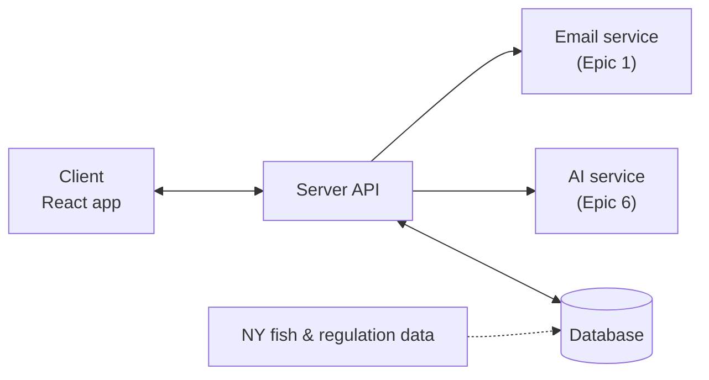

# FishLens

A field guide app for New York anglers. FishLens helps users identify fish, look up
species information and state fishing regulations, log their catches, and connect
with other anglers through following, groups, and competitions.

Built as a CSC 325 Software Engineering capstone project at Farmingdale State College.

**Live demo:** https://fish-lens-ruddy.vercel.app

## Requirements

See [spec.md](spec.md) for the full requirements, organized into six epics with
user stories and acceptance criteria. Work is tracked in the repo's Issues tab.

## Tech stack

- React + TypeScript
- Vite (development server and build tool)
- Deployed on Vercel

## Architecture

FishLens uses a **client/server architecture**.

- **Client:** a React + TypeScript single-page app that runs on the user's phone or browser.
  It displays the screens and uses device features (camera, location).
- **Server:** a backend API that stores shared data, enforces security and privacy rules,
  and connects to outside services.

**Why client/server:** Many features in `spec.md` need data shared between users or kept
secure, such as accounts on any device (Epic 1), following other users (Epic 3), group
competitions (Epic 4), a shared NY fish database (Epic 5), and AI services that require
secret API keys (Epic 6).



| Server part | Handles | Epic |
|---|---|---|
| Accounts & Security | Sign in, registration, verification, trust levels | 1 |
| Profiles & Catches | Profiles, pictures, catch history | 2 |
| Social | Following, private accounts, timeline | 3 |
| Groups & Competitions | Group membership, competitions | 4 |
| Fish Info & Regulations | Species, regulations, licenses, protected species | 5 |
| AI Gateway | Fish identification and AI assistant | 6 |

**Current status:** Epic 1 (User Stories 1.1–1.4) is implemented client-only, with accounts
stored in the browser's `localStorage`. The server will replace this storage as later epics
are built. Specific server and database technologies are still TBD.

## Getting started

You'll need [Git](https://git-scm.com) and [Node.js](https://nodejs.org) (LTS version).

```bash
git clone https://github.com/carlosgonzal100/FishLens.git
cd FishLens
npm install
npm run dev
```

Then open http://localhost:8443 in your browser.

## Project structure

- `src/main.tsx`: entry point that starts the React app
- `src/App.tsx`: top-level component that decides which screen to show
- `src/screens/`: full pages (starter, sign in, register, dashboard)
- `src/components/`: reusable UI pieces
- `src/auth/`: account storage and session logic

## Test Plan Overview

FishLens will be tested at two levels: **unit testing** and **integration testing**. Each level
answers a different question, and each catches problems the other can miss. Every test case is
based on the acceptance criteria in `spec.md`, so each test can be traced back to a user story.

### Testing Tools

| Tool | Purpose |
|---|---|
| **Vitest** | Runs all unit and integration tests (the test runner for Vite projects) |
| **React Testing Library** + **user-event** | Displays a screen and simulates a user typing and clicking (integration tests) |
| **jsdom** | A simulated browser that gives tests access to `localStorage` and a page to draw screens on |

Tests are run with `npm test`. Browser storage is cleared before each test so that tests do not
affect each other.

---

### 1. Unit Testing

**Question it answers:** Does each individual function work correctly on its own?

Unit tests call a single function with chosen inputs and check the value it returns, without
displaying any screens.

**What will be unit tested**
- Session functions in `src/auth/session.ts`: `isSignedIn`, `startSession`, `endSession`
- Account functions in `src/auth/accounts.ts`: `hashPassword`, `loadAccounts`, `addAccount`
- Registration rules (User Story 1.2), once they are moved out of `RegisterScreen.tsx` into
  their own validation function

**Example test cases**

| User story | Test | Expected result |
|---|---|---|
| 1.1 | `isSignedIn()` for a new visitor | `false` |
| 1.1 | `startSession()`, then `isSignedIn()` | `true` |
| 1.4 | `startSession()`, `endSession()`, then `isSignedIn()` | `false` |
| 1.2 | `hashPassword("Fish!2024")` | A hash that is not equal to `"Fish!2024"`; the same password always gives the same hash |
| 1.2 | `loadAccounts()` when saved data is corrupted | An empty list instead of a crash |

**Boundary value tests for registration (User Story 1.2)**

Because the spec gives exact limits, these tests check the value just below, exactly at,
and just above each limit.

| Rule | Test values | Expected result |
|---|---|---|
| First/last name is 3–20 letters | 2 / 3 / 20 / 21 letters | Rejected / accepted / accepted / rejected |
| Username is 8–16 characters | 7 / 8 / 16 / 17 characters | Rejected / accepted / accepted / rejected |
| Password has 8+ characters, a letter, a number, and a special character | `"abc12!x"` (7 chars) / `"abcdefg1"` (no special) / `"abcdef1!"` | Rejected / rejected / accepted |

---

### 2. Integration Testing

**Question it answers:** Do the screens, account storage, and sign-in session work correctly
together?

Integration tests display a real screen, type and click the way a user would, and check what
the user sees. Unlike unit tests, they use the real screens and the real account and session
code together, so they catch problems that only appear when the pieces are connected.

**Example test cases**

| User story | Scenario | Expected result |
|---|---|---|
| 1.3 | Sign in with a saved account's username and the wrong password | "Incorrect username or password" is shown; the user is not signed in |
| 1.3 | Sign in with a saved account's correct username and password | The user is signed in and taken to the dashboard |
| 1.2 | Register with a username or email that is already in use | The account is not created and an "already in use" message is shown |
| 1.2 → 1.3 | Register a new account, then sign in with it | Sign-in succeeds |
| 1.1 / 1.4 | Sign out, then try to reach the dashboard | The user is sent back to the starter screen |


## Current limitations

Accounts are currently stored in the browser's localStorage, so they only exist on
one device and browser. A backend with a shared database will be needed for features
that involve multiple users (following, groups, competitions).


## Attribution & Sources:
database from fishbase.org under Attribution-NonCommercial 4.0 https://creativecommons.org/licenses/by-nc/4.0/:

https://fishbase.org/country/CountryChecklist.php?what=list&trpp=50&c_code=840&csub_code=US-NY&cpresence=present&vhabitat=all2&ext_CL=on&ext_pic=on

New York State Fishing Regulations:

https://dec.ny.gov/things-to-do/freshwater-fishing/regulations


## Context Diagram

This is the system of our current workflow for our product FishLens: 

https://app.diagrams.net/#G1QbGMAqkn2zj-Kk2GKa9mPZfIvE18F7Yb#%7B%22pageId%22%3A%22cr7kqduUnIDSK3jMJ_eB%22%7D
